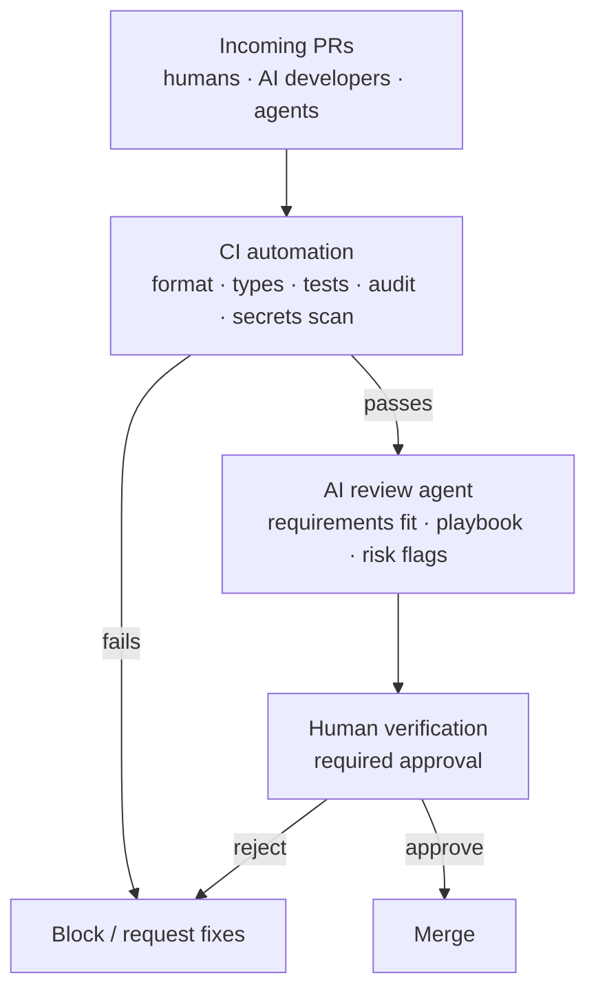
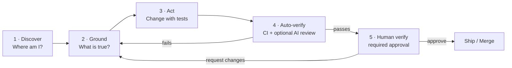
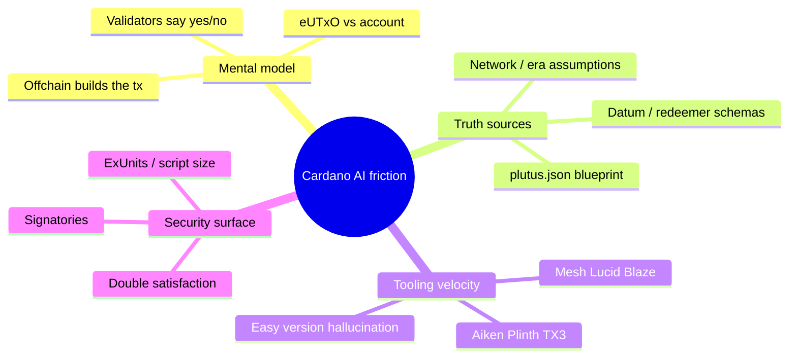
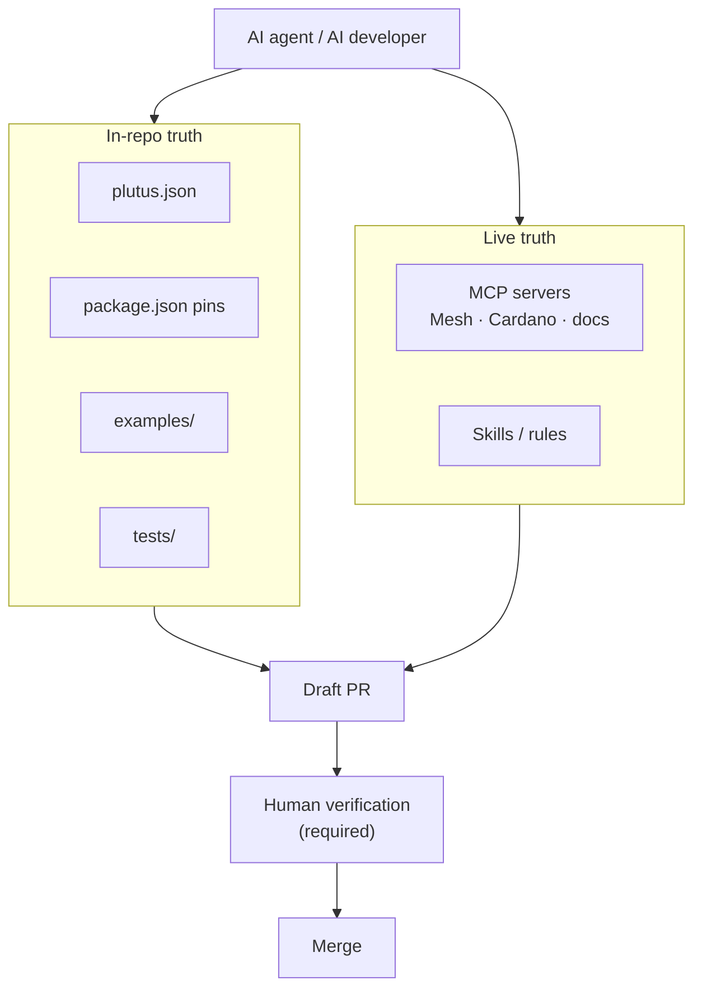
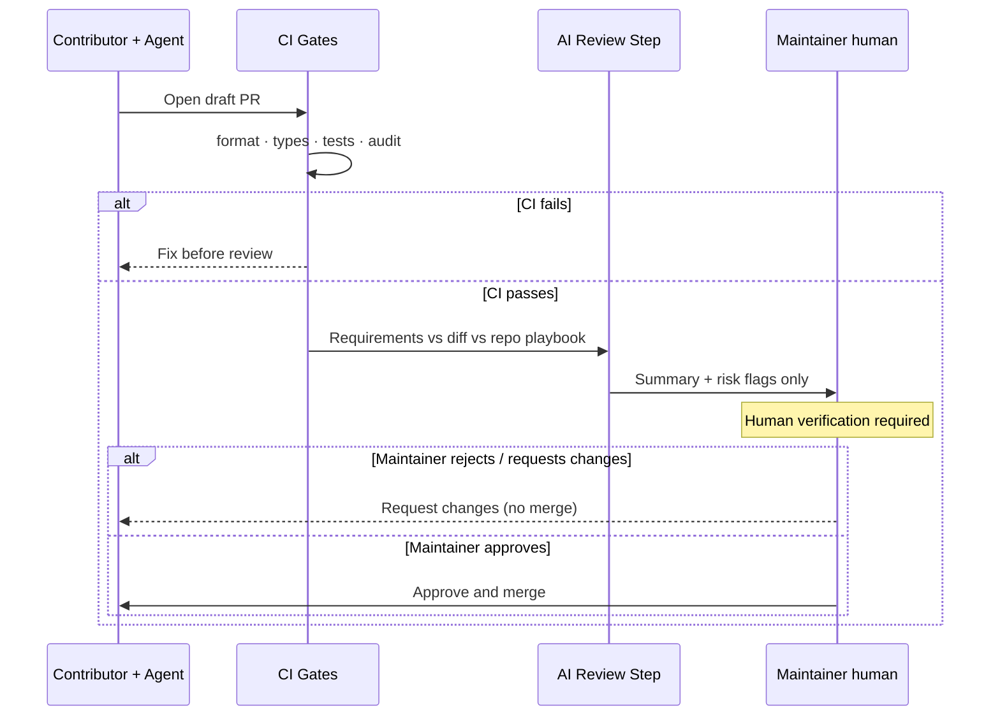

# How Can We Make Cardano Repositories Ready for AI Agents and AI Developers?


:::tip If you remember one thing
An AI agent is only as good as the **repository contract** you give it. On Cardano, that contract is architecture, blueprint, pinned versions, tests, and gates. **CI and AI review never replace a human.** Every merge still needs a human verification process.
:::

:::danger Non-negotiable: human verification
Agents may draft, test, and propose. **Humans approve.** No auto-merge of agent-authored or AI-assisted changes into protected branches. Branch protection + required human review stays on.
:::

---

## Why We Need AI Automation, CI, and AI Review to Protect Repos

The contributor surface is changing faster than traditional review can absorb.

**More AI developers and agents are opening PRs.** Coding assistants and autonomous agents can draft a pull request in minutes. Volume goes up; average context depth often goes down. A maintainer who used to review a handful of careful human patches now faces a queue of agent-shaped diffs that *look* plausible.

**Malicious and reckless code scales with that volume.** Not every bad PR is intentional, but both classes land in the same inbox:

| Risk | What it looks like | Why humans alone struggle |
|---|---|---|
| **Malicious PRs** | Dependency confusion, hidden install scripts, poisoned workflows, wallet/drain helpers, secret exfiltration | Easy to bury in a large AI-looking diff |
| **Reckless AI PRs** | Hallucinated APIs, wrong network, skipped tests, "fixes" that weaken validators | Green formatting masks broken Cardano assumptions |
| **Supply-chain noise** | Drive-by dependency bumps, lockfile churn, Action pin drift | Reviewers burn time on low-signal changes |
| **Review fatigue** | Dozens of similar "agent" PRs per week | Important issues get rubber-stamped or delayed |

Without defenses, the default outcome is either **merge unsafe code** or **burn out maintainers**.

### What each layer protects



| Layer | Job | What it is *not* |
|---|---|---|
| **CI automation** | Cheap, deterministic gates: build, tests, lint, dependency/audit, secret scans, required checks on protected branches | Not a substitute for intent or security judgment |
| **AI review agent** | Scale first-pass review: does the diff match the issue, respect `AGENTS.md`, flag dangerous patterns before a human opens the file | Not an approver; never merges |
| **Human verification** | Final authority: correctness, Cardano invariants, trust | Not optional when agents are in the loop |

We add these layers **because the attack and noise surface grew**, not because we want fewer humans. Humans stay in the merge path; automation protects their attention so they can spend it on the PRs that matter.

---

## The Provocation

AI coding tools are already in the Cardano workflow ([Session 18](../../../q2-2026/18-cardano-ai-dev-workflow/session-notes/readme.md)). Purpose-built MCP servers can expose chain state and docs to agents ([Session 19](../../../q2-2026/19-cardano-mcp-server/session-notes/readme.md)).

So the bottleneck is shifting.

> **It is no longer "can the model write TypeScript?"**  
> **It is "can this repository teach an agent how to contribute without breaking eUTxO invariants, and can maintainers survive the PR volume without merging malice or mistakes?"**

Most Cardano repos were designed for **human onboarding**. This session asks what changes when the next contributor is an **agent** (or a human steering one), and how **CI + AI review + human verification** keep the repo safe.

---

## Opening Graphic: The Agent Loop


*Animated loop used in the live deck: every successful AI contribution travels this circle.*




| Stage | Human experience | Agent experience (when repo is ready) |
|---|---|---|
| **Discover** | Skims README, asks in Discord | Reads a machine-clear map of packages, entrypoints, networks |
| **Ground** | Copies snippets, guesses versions | Pulls blueprint, pinned SDKs, MCP docs, reference patterns |
| **Act** | Writes a PR | Implements against tests / stubs first |
| **Auto-verify** | Waits on CI | CI + optional AI review filter noise |
| **Human verify** | Maintainer **must** approve before merge | Agent never merges; waits for human sign-off |

---

## Why Cardano Repos Need Extra Design

Generic "AI-friendly repo" advice (clear README, lint, tests) is necessary but **not sufficient** on Cardano.



:::warning The silent failure mode
An agent can produce a **green TypeScript build** and still ship a validator that fails double-satisfaction review, burns ExUnits, or targets the wrong network. Repo readiness must encode *Cardano correctness*, not only *compile success*.
:::

---

## Slide Deck: What "AI-Ready" Looks Like

### Slide 1 — Readiness Scorecard


Score your own repo live (0–2 points each). **8+** is "agent-friendly"; **under 5** is "agent roulette."

| # | Capability | Weak signal | Strong signal |
|---|---|---|---|
| 1 | **Map** | Sparse README | Architecture diagram + package map + "start here" path |
| 2 | **Playbook** | Tribal knowledge in maintainers' heads | `AGENTS.md` / rules / skills describing how to change code |
| 3 | **Truth** | Docs drift from code | Blueprint, schemas, pinned versions, MCP or skills for live docs |
| 4 | **Tests** | Manual smoke only | Deterministic unit / emulator tests agents can run |
| 5 | **Gates** | Merge on vibes / auto-merge on | Format, types, tests, optional AI review, then **required human approval** (no auto-merge) |

### Slide 2 — Repository Layout Agents Can Parse

A concrete target layout for many Cardano projects:

```text
repo/
├── README.md                 ← human + agent entry: purpose, map, networks
├── AGENTS.md                 ← how agents should work here (do / don't)
├── ARCHITECTURE.md           ← components, trust boundaries, data flow
├── docs/                     ← versioned how-tos (not only marketing)
├── onchain/
│   ├── validators/
│   └── plutus.json           ← blueprint = ground truth
├── offchain/ or sdk/
│   ├── package.json          ← pinned versions, scripts agents can run
│   └── examples/             ← golden paths (one script per flow)
├── .github/workflows/        ← verify before merge
└── .cursor/rules/ or skills/ ← optional editor/agent conventions
```

Names can vary. The **contract** cannot: *entry map → playbook → truth → tests → auto-gates → human verification*.

### Slide 3 — Write `AGENTS.md` Like a Runbook

Treat it as instructions for a smart junior who has never seen Cardano before:

```markdown
# AGENTS.md (pattern)

## Mission
What this repo does in one paragraph.

## Hard rules
- Do not invent SDK APIs; pin versions from package.json
- Prefer blueprint fields over guessed datum shapes
- Never "mutate state"; consume UTxOs and create new outputs
- Target network: Preview / Preprod / Mainnet (explicit)
- Never merge your own PR; always wait for human verification

## How to change code
1. Read ARCHITECTURE.md and the relevant blueprint section
2. Add / update tests first
3. Implement the smallest diff that passes tests
4. Run: npm test && npm run build
5. Open a draft PR and stop; a human must review and approve

## Do not
- Commit secrets
- Expand PR scope beyond the issue
- Skip ExUnits / signatory / double-satisfaction review for on-chain changes
- Enable or use auto-merge for AI-authored changes
- Treat green CI as permission to ship without a human
```

### Slide 4 — Grounding Surfaces (Beyond Chat Paste)



| Surface | Agent use | Cardano-specific tip |
|---|---|---|
| Blueprint | Field names, hashes, script purposes | Prefer this over prose when schemas disagree |
| Pinned SDKs | Stop API mixing | Name the package + major version in the playbook |
| Examples | Few-shot patterns | Keep them green in CI |
| MCP | Live docs / chain tools | See Session 19; Mesh already ships skills + MCP |
| Rules / skills | Encode review habits | ExUnits, required signers, output pinning, **human-must-approve** |

### Slide 5 — Maintainer View: Volume Without Chaos

As AI raises contribution volume, maintainers need **filters**, not more heroics. Automation prepares the PR; a **human always owns the merge decision**.



Practical defaults (also from Session 18):

1. Keep PRs in **draft** until automated checks pass.
2. Optional AI review may summarize risk; it **cannot** approve or merge.
3. Require at least one **human code owner / maintainer** approval on protected branches.
4. Leave **auto-merge off** for AI-assisted contributions (especially on-chain / SDK / secrets-adjacent paths).

---

## Discussion Agenda (Live Session)

Use these prompts to collect ecosystem practice, not only theory:

1. **What broke first** when you pointed an agent at a Cardano repo?
2. Which **single file** would have saved the most tokens / retries?
3. Should Intersect / DevEx publish a shared **`AGENTS.md` template** for Cardano repos?
4. Which repos should ship **MCP** first: on-chain languages, SDKs, or infrastructure?
5. How do we keep **human verification always required** as agents get faster (branch rules, CODEOWNERS, no auto-merge)?

Capture answers in the recording notes and feed them into a follow-up checklist PR if the WG agrees.

---

## Working Checklist: Make *Your* Repo AI-Ready This Week

- [ ] One-screen **map** in README (packages, networks, "run this first")
- [ ] Add **`AGENTS.md`** (or equivalent rules/skills) with hard Cardano constraints **and** "wait for human approval"
- [ ] Link the **blueprint** and declare pinned off-chain versions
- [ ] Ensure **one golden example** runs headlessly in CI
- [ ] Add or tighten **verify workflow** (format, types, tests)
- [ ] Document **review risks** for on-chain diffs (signers, outputs, ExUnits)
- [ ] Enforce **human verification**: branch protection, required reviewers / CODEOWNERS, auto-merge **off**
- [ ] Optional: expose docs via **MCP / skills** for agent grounding

---

## Continuity With Prior Sessions

| Session | What it gave us | How Session 22 uses it |
|---|---|---|
| [18 · AI Dev Workflow](../../../q2-2026/18-cardano-ai-dev-workflow/session-notes/readme.md) | Orchestrate, ground, TDD, audit | Repo must *host* those grounding surfaces |
| [19 · Cardano MCP](../../../q2-2026/19-cardano-mcp-server/session-notes/readme.md) | Live tools for agents | Repos should declare which MCP/tools they expect |
| [21 · Production SDK](../../../q2-2026/21-cardano-production-sdk/session-notes/readme.md) | Blueprint → SDK → examples → CI | That stack *is* the AI-ready pattern in practice |

---

## Key Takeaways

- **PR volume and risk are rising** with AI developers and agents; some diffs are noisy, some are malicious.
- Protect repos with **CI automation + AI review + required human verification** (never auto-merge).
- **AI-ready is a repo property**, not a model property.
- Design for the loop: **Discover → Ground → Act → Auto-verify → Human verify**.
- Encode Cardano truth locally: **blueprint, pins, examples, tests**.
- Give agents a **playbook** (`AGENTS.md` / rules) that forbids account-model assumptions.
- Treat tonight's discussion as input to a shared DevEx template for the ecosystem.

---

*These notes belong to the Q4 2026 Developer Experience Working Group.*
