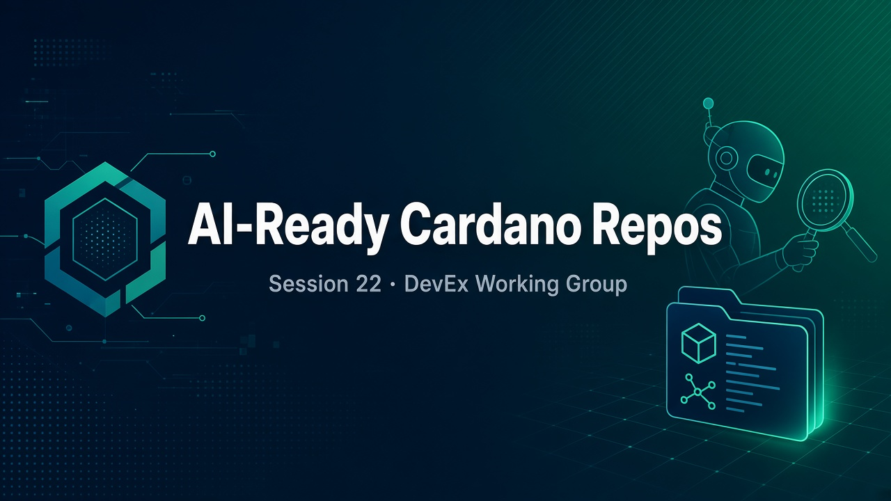
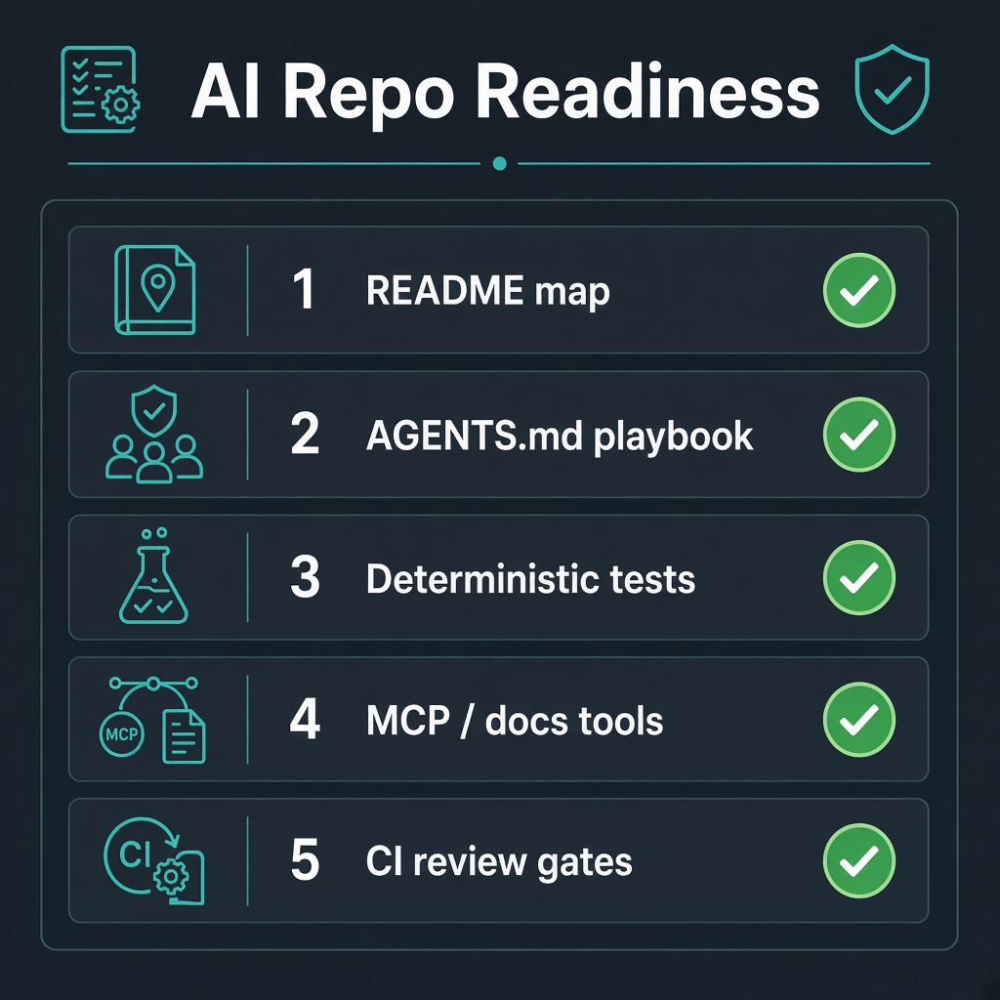
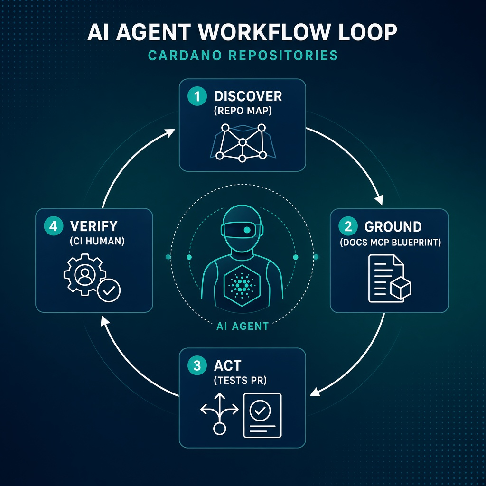

# Session 22: AI-Ready Cardano Repositories - Resources

Graphics, references, and follow-along links for making Cardano GitHub repositories usable by AI agents and AI-powered developers.

## Session Graphics

| Asset | Use |
|---|---|
|  | Opening / social slide |
|  | Live scoring exercise |
|  | Loop overview still |
|  | Animated Discover → Ground → Act → Verify (human approval still required after this loop) |

## Live Session

- **Meet:** [https://meet.google.com/npt-phro-wja](https://meet.google.com/npt-phro-wja)
- **Time:** 17 September 2026 · 18:00 UTC
- **Topic:** How can we structure Cardano repositories so AI agents and AI developers can understand, test, review, and contribute?

## Prior DevEx Sessions (Context)

- [Session 18: Using AI in Your Cardano Dev Workflow](../../../q2-2026/18-cardano-ai-dev-workflow/session-notes/readme.md)
- [Session 19: Production-Grade MCP Server for Cardano](../../../q2-2026/19-cardano-mcp-server/session-notes/readme.md)
- [Session 21: Building a Production Cardano SDK](../../../q2-2026/21-cardano-production-sdk/session-notes/readme.md)

## Standards & Protocols

- **[Model Context Protocol](https://modelcontextprotocol.io)**: How assistants attach to live tools and docs
- **[Mesh SDK AI tooling](https://meshjs.dev)**: Skills + MCP for version-accurate Mesh development
- **Blueprint / `plutus.json`**: Treat as schema truth for validators and off-chain bindings

## Suggested Repo Artifacts

| Artifact | Why agents need it |
|---|---|
| `README.md` map | Discovery without Discord tribal knowledge |
| `AGENTS.md` / editor rules | Encodes do / don't and Cardano constraints |
| `ARCHITECTURE.md` | Trust boundaries and package roles |
| `plutus.json` | Stops hallucinated datum / redeemer shapes |
| `examples/` + CI | Golden paths agents can run and copy |
| Workflows + branch protection | Auto checks first; **human verification always required** before merge (no auto-merge) |

## Tools Mentioned Across the AI Track

- Assistants: Claude Code, Cursor, Kiro, Gemini
- Local models (cost control): Ollama + Qwen / Gemma
- Cardano SDKs: Mesh, Lucid Evolution, Blaze
- On-chain: Aiken, Plutus / Plinth, TX3, Scalus

## Human verification (always)

- Agents draft PRs; **humans approve**.
- Keep required reviewers / CODEOWNERS on protected branches.
- Do not enable auto-merge for AI-assisted contributions.
- Green CI is necessary, not sufficient, to ship.

## After the Call

- Paste community checklist ideas into a follow-up issue or PR
- Score 1–2 of your own repos with the readiness table in the [session notes](../session-notes/readme.md)
- Confirm each scored repo still has a **human verification** path before merge
- If a recording is published, it will land on the [recordings page](../recordings/readme.md)

---

*These resources belong to the Q4 2026 Developer Experience Working Group.*
